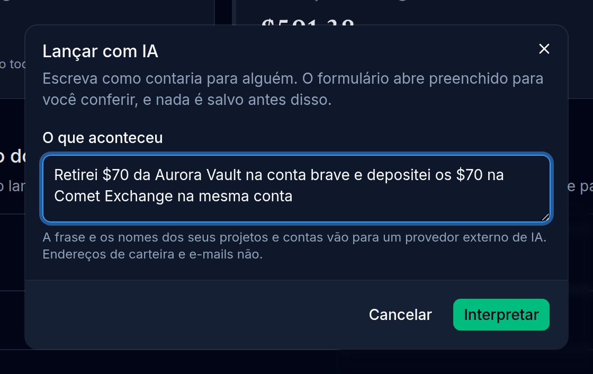
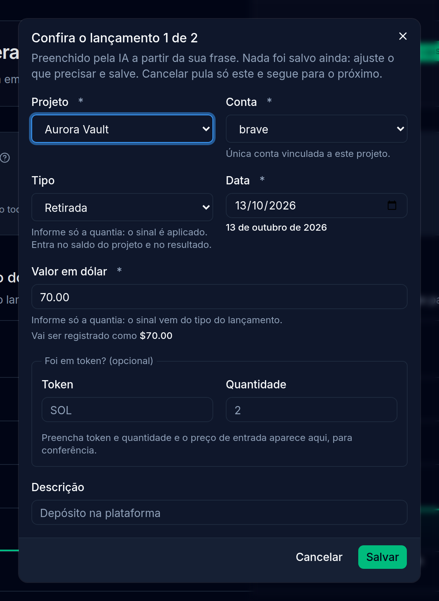
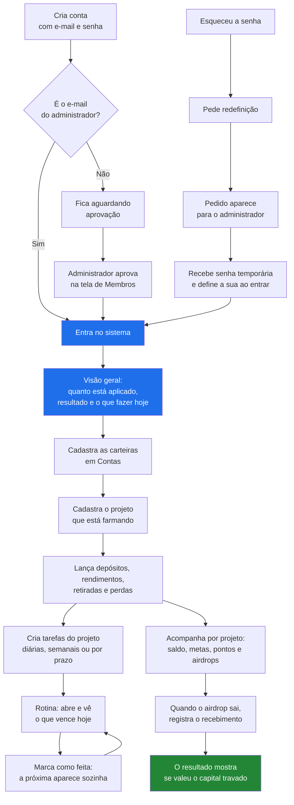
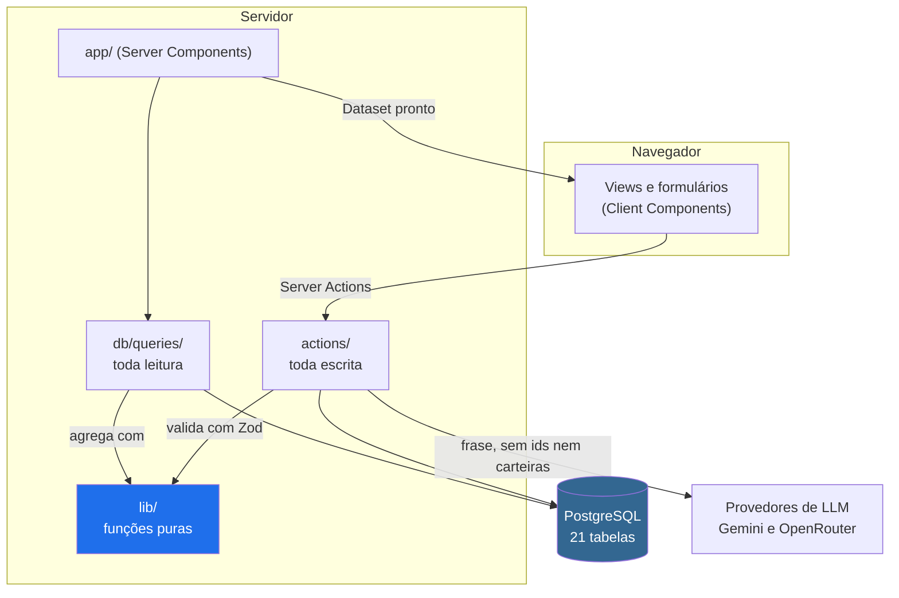
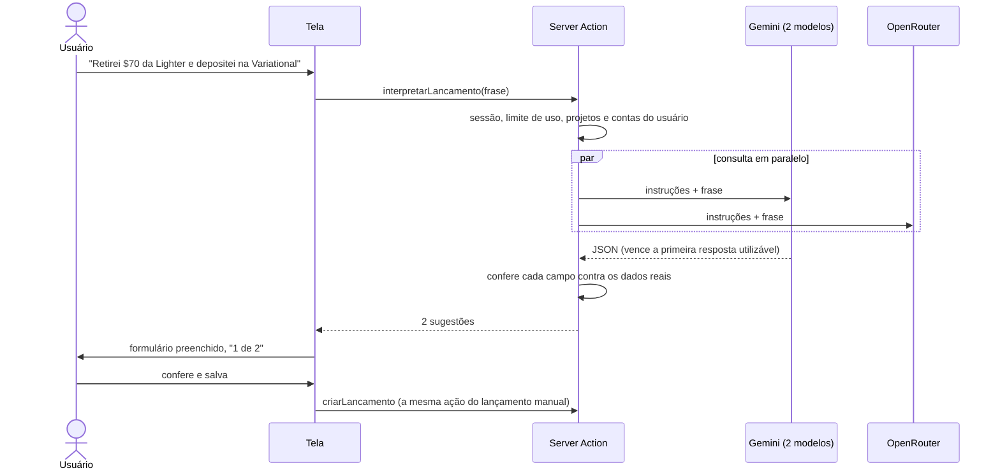

# LVL Airdrops

[](https://github.com/arturnery/airdrop-tracker/actions/workflows/ci.yml)


Controle financeiro para quem farma airdrops em várias carteiras ao mesmo tempo: quanto foi
aportado, o que precisa ser feito hoje e qual o resultado real, por projeto e por conta.

Substitui uma planilha onde depósito e saldo dividiam a mesma coluna. Isso parece um
detalhe de organização e não é: torna **todo somatório incorreto**, porque somar um aporte
de US$ 100 com uma leitura de saldo de US$ 103 produz US$ 203 de nada. Separar fluxo de
caixa de foto de saldo é a decisão central do modelo de dados, e é dela que sai o resto do
projeto.

> **Trabalho freelancer para a [Level Cripto](https://www.levelcripto.com.br)**, segundo
> projeto entregue para o mesmo cliente, depois da landing page da plataforma. A ferramenta
> nasceu de uma necessidade concreta da comunidade, e é usada por ela: por isso o cadastro
> tem aprovação manual e cada assinante enxerga apenas os próprios dados.

**Lançamento por linguagem natural, com LLM.** "Retirei $70 da Lighter na conta chrome e
depositei na Variational na mesma conta" vira dois lançamentos já preenchidos, esperando
conferência. A integração usa Gemini e OpenRouter pela API compatível com a OpenAI, valida
a saída do modelo contra os dados reais de quem usa, consulta dois provedores em paralelo
para sobreviver à instabilidade do plano gratuito e tem teto de custo, porque a conta de
demonstração é pública. [Como funciona e por quê](#integração-com-llm-lançamento-por-frase).

## Testar sem instalar nada

**[Abrir a aplicação](https://lvl-airdrop.vercel.app)** e entrar com:

```
e-mail: demo@airdrop-tracker.app
senha:  teste@1234
```

A conta já vem com projetos, lançamentos e tarefas de exemplo. Pode criar, editar e excluir
à vontade: os dados são fictícios e ficam isolados dessa conta.

Só duas coisas ficam travadas nela, nome e senha, porque valem para todo mundo que entra
pelo mesmo login. Cadastros novos entram numa fila de aprovação manual.

Para ver a integração com LLM: **Lançar com IA**, na Visão geral, e uma frase como
*"retirei $70 da Meridian na conta brave e depositei na Nebula na mesma conta"*. A conta
brave não está vinculada à Nebula nos dados de exemplo, então o segundo formulário também
mostra um aviso, que é a conferência funcionando.

## Demonstração

**Lançar com IA.** A frase vira formulários preenchidos, um por operação. Nada é salvo
antes da conferência, e o que a IA não conseguiu decidir aparece em branco, com um aviso.

<p>
  
  
</p>

**Visão geral.** Os quatro indicadores no topo, as tarefas do dia e a distribuição do capital
por projeto. Cada número tem uma interrogação que explica como ele é calculado.


**Projetos.** Busca por nome e filtros de status, categoria e prioridade. Cada card destaca o
resultado, com a cor e a seta dizendo a direção, e mostra exposição e capital ao lado.


**Contas.** A mesma carteira atravessando vários projetos, que é a visão que a planilha não
conseguia dar.


**Histórico.** Tudo que foi feito, do mais recente para o mais antigo, com filtro por tipo e
por projeto.


**Entrada.** Cadastro com aprovação manual: a ferramenta é usada por uma comunidade, e cada
assinante enxerga apenas os próprios dados.


## Como funciona, na prática

O caminho de quem usa, do primeiro acesso ao dia a dia. Este é o fluxo **funcional**: a
arquitetura técnica está mais abaixo.



Cada pessoa enxerga apenas os próprios dados. O administrador aprova quem entra e gera
senhas temporárias, mas não vê o farming de ninguém.

## Funcionalidades

- **Lançar com IA.** Uma frase em português vira um ou mais registros preenchidos, cada um
  no formulário do seu tipo: lançamento ("tomei um loss de 42,50 na Backpack ontem e
  paguei 1,20 de gás"), pontos e volume ("ganhei 300 pontos na Lighter", somados à última
  medição porque o formulário pede o total) e airdrop recebido ("caíram 3.000 SLX a
  $0,12"). A pessoa confere e salva pelo mesmo formulário do registro manual.
- **Comunidade.** Área separada da de airdrops, com conteúdo igual para todos. Começa pelo
  calendário mensal de lives da Level Cripto, no formato de grade que a comunidade já usa
  para divulgar a programação: cadastrado por quem administra, com lives semanais e
  quinzenais calculadas na leitura (sem cron), data final opcional, evento em destaque e
  horário de Brasília.
- **Trade: operações lidas de print por IA.** Quem publica cola o print da operação, um modelo
  com visão (Gemini) devolve ativo, direção, entrada, stop e alvos, e o formulário abre para
  conferência. A validação recusa operação incoerente (numa compra, stop abaixo da entrada e
  alvos acima) e mostra o risco/retorno de cada alvo. Operação nova acende um sininho no menu
  e é avisada num canal do Discord por webhook, com o envio confirmado e reenviável. Ao
  fechar, escolhe-se por onde a operação saiu (um alvo, o stop, outro preço, ou não acionou); o
  resultado em % e em R sai do preço, nunca é digitado, e a aba Resultados soma o placar, com simulação opcional em dólar.
  Cada membro pode **entrar** numa operação aberta informando o valor em dólar, e o resultado
  dele em dólar aparece quando ela fecha.
- **Todos os projetos e Farmando agora.** Duas abas: os destaques ativos do admin para
  adicionar e os projetos fora do farm, por status; e a carteira do que se está farmando, com
  depositado, exposição, resultado e ROI em cada card. Sair do farm exige o motivo, que vira
  o status do projeto. Quando o admin muda o status de um destaque, quem o adicionou é
  avisado no card e decide se atualiza o seu.
- **Ranking da comunidade.** Resultado de cada membro (o mesmo número da Visão geral dele,
  calculado pelos mesmos selectors) e pontos por projeto, com o feed dos últimos airdrops.
  Todos entram, e quem não quer expor os números sai pelo perfil; conta de demonstração
  nunca aparece em produção.
- **Compartilhar no X.** Em pontos, volume e resultado de cada projeto, um botão abre o X
  com o post pronto: a evolução do período, o @ do projeto e a divulgação da comunidade
  Level Cripto Pro. Sem API do X: é o link de publicação, e quem publica é a pessoa.
- **Livro-razão por projeto e conta.** Aportes, rendimentos, retiradas e taxas como
  lançamentos datados. Não existe registro de saldo: o saldo é resultado, não entrada.
- **Aportes em token.** Registrar "1 SOL, US$ 50" calcula o preço de entrada sozinho; o
  aporte entra no saldo pelo valor em dólar lançado, sem revalorização por preço de mercado.
- **Programas de pontos.** Medições periódicas por projeto e conta, com evolução entre
  medições, para os projetos que distribuem por pontuação em vez de volume.
- **Tarefas recorrentes.** Diária, semanal, mensal ou a cada N dias, expandidas por conta,
  com conclusão em um clique e destaque para o que está atrasado. As ocorrências são
  calculadas na leitura, sem cron: um job que não roda deixa o dia sem tarefas em silêncio,
  e recalcular não tem estado a perder.
- **Metas e recebimentos.** Objetivos por projeto, com progresso derivado dos lançamentos,
  e registro dos airdrops efetivamente recebidos.
- **Recuperação do próprio administrador.** Quem administra não pode gerar a própria senha,
  senão um admin poderia assumir a conta de outro. O acesso volta por um script que libera a
  conta para ser reivindicada pela tela, sem senha passando pelo terminal.
- **Recuperação de senha sem serviço de e-mail.** O pedido entra numa fila de
  administração, quem administra gera uma senha temporária, e o primeiro acesso com ela
  exige definir a própria. Para uma comunidade fechada com aprovação manual, e-mail
  transacional é infraestrutura que não se paga.
- **Suporte com contexto.** O relato leva sozinho a tela de origem, a versão e quem
  enviou, o que costuma bastar para o diagnóstico começar do lugar certo. A resposta sai
  por e-mail, com o rascunho já montado.
- **Múltiplos usuários com aprovação manual.** Cadastro livre, entrada só depois de
  liberada. Cada pessoa enxerga exclusivamente os próprios dados.

## Stack

| Camada | Escolha | Versão |
|---|---|---|
| Framework | Next.js (App Router, Server Components, Server Actions) | 16.2 |
| UI | React | 19.2 |
| Linguagem | TypeScript, modo `strict` | 5 |
| Banco | PostgreSQL serverless (Neon) | |
| ORM | Drizzle | 0.45 |
| Validação | Zod | 4.4 |
| Autenticação | Auth.js (next-auth), Credentials + JWT | 5 |
| Estilo | Tailwind CSS + shadcn/ui (Radix) | 4 |
| Gráficos | Recharts | 3.10 |
| LLM | Gemini (Google AI Studio) e OpenRouter, pela API de chat compatível com a OpenAI, sem SDK | |
| Testes | Vitest | 4.1 |
| Hospedagem | Vercel | |

## Arquitetura

Três fronteiras, cada uma com um mecanismo que a torna difícil de furar sem querer.



1. **Nenhum componente fala com o ORM.** Leitura passa por `db/queries`, escrita por
   `actions/`. A regra é convenção, mas a próxima não é.
2. **Todo arquivo em `db/` começa com `import "server-only"`.** Um import acidental no
   cliente vira erro de build, em vez de vazar a string de conexão no bundle enviado ao
   navegador. Convenção que o compilador cobra.
3. **`lib/` não conhece a origem dos dados.** São funções puras de `(Dataset, ...) => X`.
   Isso soa acadêmico até render (ver os trade-offs abaixo).

## Decisões técnicas e trade-offs

### Integração com LLM: lançamento por frase

Lançar à mão são seis campos por operação, e uma transferência entre projetos são duas
operações. A frase que a pessoa diria em voz alta já tem tudo isso; o trabalho do modelo é
transformá-la nos campos, e o do sistema é não confiar cegamente no resultado.



**A IA sugere, não grava.** A sugestão abre o mesmo formulário do lançamento manual, e o
salvar passa pela mesma Server Action e pelo mesmo schema Zod. Num livro-razão, um campo
errado em silêncio (conta trocada, data de outro mês) distorce resultado, gráfico e ROI
dali em diante. Um clique de conferência é barato perto disso. E não existe um segundo
formulário "da IA" para envelhecer separado do original.

**Saída do modelo é entrada não confiável.** O modelo responde em modo JSON, e cada campo
é conferido contra os dados reais de quem usa
([`lib/interpretar-lancamento.ts`](lib/interpretar-lancamento.ts)). Campo que não passa
vira campo em branco com aviso, nunca a sugestão inteira recusada. Os casos abaixo
aconteceram com modelos de verdade, não são hipotéticos:

| O modelo devolveu | O que o sistema faz |
|---|---|
| Uma lista solta, quando o pedido era um objeto com a lista dentro | Aceita os três formatos que modelos de fato devolvem |
| O nome do projeto ("Lighter") no lugar do apelido pedido (`P1`) | Aceita o nome **exato**; parecido não é adivinhado |
| Conta que não está vinculada ao projeto | Descarta e avisa: o select da tela mostraria outra conta no lugar |
| Data no futuro ou impossível ("2026-02-30") | Deixa em branco e avisa |
| Texto de raciocínio em vez de JSON | A resposta não vence a disputa entre provedores |

O campo que fica sem resposta também gera aviso, porque um select vazio mostra a primeira
opção, e ela pareceria escolha da IA.

**O provedor recebe o mínimo.** Projetos e contas viajam como apelidos (`P1`, `C2`) com o
nome que a pessoa já usa. Nenhum identificador interno, endereço de carteira ou e-mail sai
do servidor, e a tela diz isso embaixo do campo de texto. A frase vai separada das
instruções, como mensagem do usuário, e mesmo uma frase escrita para manipular o modelo só
consegue preencher campos que a pessoa vai ver antes de salvar.

**Provedor é configuração, não código.** A chamada é um `fetch` para o endpoint de chat no
formato da OpenAI, que quase todo provedor aceita. Trocar de provedor é trocar
`IA_BASE_URL`, `IA_API_KEY` e `IA_MODELO`. Foi assim que o projeto saiu do DeepSeek
(planejado) para o Gemini gratuito, e depois ganhou o OpenRouter como segundo provedor, sem
mexer no código que conversa com o modelo.

**Resiliência medida, não presumida.** O plano gratuito do Gemini não tem tempo de
resposta: a mesma frase levou de 2 a 58 segundos, e num mesmo minuto quatro de sete
modelos estavam travados ou devolvendo "alta demanda" (503). Esperar um modelo travado para
só depois tentar outro gastava o prazo inteiro no modelo errado. A chamada virou uma
disputa ([`lib/perguntar-ia.ts`](lib/perguntar-ia.ts)): dois modelos do Google e um do
OpenRouter são consultados ao mesmo tempo, vence a primeira resposta **utilizável** e os
outros são cancelados.

| Falha | Reação |
|---|---|
| Rede caída, 5xx, "alta demanda" | Passageira: entra numa segunda rodada, depois de 2 s |
| Cota esgotada (429), chave recusada, modelo descontinuado | Definitiva: não repete, porque daria o mesmo erro e gastaria cota |
| Resposta que não se aproveita | Perde a disputa; se ninguém responder melhor, pede para reescrever a frase |
| Nada em 45 s | Desiste com mensagem própria |

Na mesma frase em que antes a pessoa via 30 segundos de espera ou um erro, as medições
seguintes ficaram entre 4 e 16 segundos, todas certas. Quando tudo falha, a tela diz o que houve ("a IA gratuita do
Google está sobrecarregada agora") e aponta o lançamento manual.

**Custo sob controle numa demonstração pública.** Cada pedido custa na chave de quem mantém
o projeto, e a senha da conta demo está publicada neste README. A Server Action recusa
acima de 30 pedidos por pessoa em 24 horas **e** de 300 no total: só o limite individual
deixaria várias contas, cada uma abaixo do teto, somarem sem limite. O pedido é contado
antes da chamada, porque erro em laço também custa, e a tabela de uso guarda quem e quando,
nunca o texto.

**Testável sem rede.** Montar as instruções, conferir a resposta e conduzir a disputa são
funções que recebem o `fetch` de fora. Os testes simulam um modelo sobrecarregado, um
travado, um que responde lixo antes do outro responder certo, a segunda rodada e o prazo
estourado. Um teste passa a sugestão pelo schema real do formulário, porque é nesse elo que
uma divergência de formato só apareceria na hora de salvar. A escolha do modelo do
OpenRouter também foi medida: sete modelos gratuitos testados com frases reais; três
acertaram a transferência entre projetos, e um só acertou também a perda com taxa e o saque
em token.

**Trade-offs assumidos.** No plano gratuito, o pior caso ainda chega perto de meio minuto, e
o provedor pode usar o que recebe para treinar modelos; por isso a tela diz o que é
enviado. O plano pago resolveria os dois por centavos ao mês, e trocar é configuração.

### O ranking não tem conta própria

O ranking da comunidade mostra o resultado e os pontos de cada membro. O jeito fácil seria uma
consulta SQL somando lançamentos por pessoa, e ela divergiria da Visão geral na primeira mudança
de regra (o resultado tem detalhes: taxas, rendimento, airdrop em token). Em vez disso, o
ranking monta o `Dataset` de cada membro com a **mesma** conversão do carregamento normal e
passa pelos **mesmos** selectors. Os testes comparam a linha de cada membro com a Visão geral
dele. Custo aceito: uma leitura por tabela para todos os membros, em vez de uma soma no banco,
o que serve à escala de uma comunidade e fica no servidor (o navegador recebe só as linhas
prontas).

### Dinheiro em inteiros, nunca em ponto flutuante

Valores são inteiros de centavos. `0.1 + 0.2 !== 0.3` em IEEE 754, e num sistema que soma
dezenas de lançamentos por conta o erro acumula até aparecer na tela. O `numeric` do
Postgres volta como string pelo Drizzle, o que é chato de manipular e é exatamente o
comportamento correto: obriga a conversão explícita em vez de deixar o JavaScript decidir.

**Trade-off:** toda entrada e saída precisa de conversão. Custa código repetitivo em
`lib/money.ts`, coberto por testes, e elimina uma classe inteira de bug silencioso.

### ROI sobre o capital parado, não sobre o total depositado

O denominador do retorno é o que está depositado **agora** (depósitos menos retiradas), não
a soma histórica dos depósitos. O motivo é a reciclagem de capital: usar os mesmos $50 em
dois projetos somaria $100 de base e derrubaria o percentual pela metade, sem nunca ter
havido mais de $50 imobilizados.

O capital nunca fica negativo, e isso não é detalhe de exibição. Depositar 50, render 10 e
sacar 60 deixaria o líquido em -10 com um lucro de +10, e `10 ÷ -10` mostraria **-100%**
para quem teve ganho. Base menor ou igual a zero devolve `null`, e a tela exibe só o
resultado em dólar: sem capital parado não existe retorno sobre capital, existe ganho
absoluto.

### Pontos são um tipo separado de dinheiro

Pontos usam inteiros escalados por 10⁴ e **não compartilham tipo com valores monetários**,
mesmo sendo os dois "números com casas decimais". Unificar economizaria código e permitiria
somar pontos com dólares sem que nada reclamasse. A separação é o ponto: o compilador
recusa a operação que não faz sentido no domínio.

### O banco recusa dados impossíveis, a aplicação não é a única guarda

Regras que estavam em código migraram para onde é mais difícil burlá-las:

| Regra | Como é garantida |
|---|---|
| Excluir projeto leva lançamentos, tarefas e metas | `ON DELETE CASCADE` |
| Uma medição de pontos por dia | `UNIQUE` + `ON CONFLICT` |
| Movimento exige par projeto×conta válido | Chave estrangeira **composta** |

A FK composta foi testada tentando inserir um lançamento órfão: o banco rejeitou. Validação
na aplicação vale para o que a aplicação escreve; a do banco vale também para o script, o
console e o engano.

### Sessão em JWT, e o que isso custou

Sem tabela de sessões: o token carrega `id` e `role`, o que mantém a autorização barata em
serverless (nenhuma consulta por requisição). O custo apareceu em uso real: **tudo que está
no token congela no login**. Trocar o nome no perfil salvava no banco e a barra lateral
seguia com o antigo.

A correção não foi reemitir o token, e sim separar duas coisas que estavam juntas:
identidade (`id`, `role`) continua vindo do token assinado, e o que é apenas exibição passa
a vir do banco. Reemitir resolveria o sintoma e deixaria a mesma armadilha para o próximo
campo editável.

### Uma conta pública que não vira um problema

Publicar credenciais num README costuma dar errado de três jeitos, e cada um pedia uma
resposta diferente:

| Risco | Resposta |
|---|---|
| Alguém troca a senha e tranca os visitantes seguintes | `is_demo` bloqueia a troca **no servidor**, não escondendo o botão |
| Alguém renomeia a conta para algo que o próximo visitante lê | Mesma trava, pelo mesmo motivo |
| A conta enxerga dados de terceiros | Papel `membro`, nunca `admin`: a fila de aprovação tem e-mails de outras pessoas |

O isolamento por usuário, que já existia, faz o resto: a conta pública vê apenas os
próprios dados, e nenhum dado real de quem mantém o projeto.

`is_demo` é uma coluna e não um valor de `role` de propósito. Um terceiro papel obrigaria a
revisar toda comparação de papel no sistema para decidir o que "demo" significa em cada
uma; a coluna deixa a autorização como estava e liga só o que precisa mudar.

A trava vive na Server Action, não no componente. Esconder o formulário no cliente não
impede a requisição direta à ação, que é o caminho que alguém realmente tentaria.

### Login que não revela quem tem conta

Senha errada, e-mail inexistente e conta não aprovada devolvem **a mesma recusa**.
Distinguir os casos transformaria a tela num verificador de quem tem cadastro. A senha é
processada mesmo quando o usuário não existe, porque responder rápido nesse caso revelaria
a mesma informação pelo tempo de resposta.

Uma exceção deliberada: o **cadastro** informa que o e-mail já existe. Isso confirma a
existência da conta, e foi escolhido mesmo assim: sem esse aviso a pessoa preenche o
formulário de novo achando que errou algo. Decisão consciente, não descuido.

### O limite de tentativas que quase virou um delator

Cinco senhas erradas em quinze minutos bloqueiam o endereço. Escrever a contagem foi a
parte fácil; a difícil foi impedir que o próprio limite contasse o que a recusa única
esconde, e havia três formas de estragar isso:

- **Responder "bloqueado"** confirmaria que aquele endereço existe. A recusa por bloqueio
  ficou idêntica à recusa por senha errada.
- **Contar só os e-mails cadastrados** parece natural, já que os inexistentes não têm o que
  proteger. Mas aí cinco erros passam a ser recusados num endereço cadastrado e não num
  inexistente, e o comportamento vira o oráculo que a mensagem evita. Conta-se o e-mail
  tentado, exista ele ou não.
- **Bloquear a conta de demonstração** só criaria um jeito barato de derrubá-la: a senha
  dela está publicada aqui neste arquivo, então não há o que descobrir por tentativa e
  erro, e cinco erros de propósito a deixariam quinze minutos recusando visitante.

O trade-off que sobra: o bloqueio é por e-mail, então dá para travar a conta de alguém de
propósito. A alternativa por IP protege menos, porque em *serverless* o IP chega por
cabeçalho e um ataque distribuído troca de IP a cada tentativa enquanto o e-mail alvo
continua o mesmo.

A decisão vive numa função pura que recebe os carimbos de tempo e o instante atual
([`lib/limite-login.ts`](lib/limite-login.ts)); o banco só busca e grava. É o que permite
testá-la sem subir Postgres, e os testes cobrem as bordas: a falha que fecha o limite, a
janela que expira e as falhas velhas que não podem completar a conta de uma nova.

### Auditar é listar as suposições e tirá-las

Antes de divulgar o projeto, uma auditoria trocou a pergunta de *"eu quebro isso sem
querer?"* para *"o que alguém consegue fazer de propósito?"*. Ela achou três defeitos, e
dois tinham a mesma raiz: eram protegidos por uma suposição sobre **como a pessoa chega
ali**, pela tela certa e na ordem certa.

Uma Server Action estava exportada sem checar papel porque só a tela de administração a
chamava. Mas toda função exportada de um arquivo `"use server"` é um endereço alcançável
por requisição direta: **em Server Action, a autorização mora dentro da ação**, nunca em
quem a chama.

O outro tinha o defeito justificado por escrito. O "esqueci minha senha" respondia igual
para todos, exceto quando já havia pedido nas últimas 24h, e o comentário no código
explicava que ali não havia o que proteger *"porque só quem tem conta chega a ter um pedido
anterior"*. A frase está certa e a conclusão invertida: era exatamente isso que vazava, e
bastava enviar o mesmo endereço duas vezes.

O isolamento entre contas não foi conferido lendo o código, e sim disparando contra o banco
os mesmos `UPDATE` e `DELETE` das Server Actions com o id de outro usuário. O script ficou
no repositório ([`npm run auditar`](scripts/auditar-isolamento.ts)), escrito para ser seguro
mesmo se encontrar o problema: o `UPDATE` grava o valor que a linha já tem e o `DELETE` é
substituído pelo `SELECT` da mesma condição. Uma auditoria que corrompe dados ao achar o
furo é pior do que não auditar.

O relatório completo, com o que foi conferido e os limites assumidos, está em
[`ARCHITECTURE.md` §16](ARCHITECTURE.md).

### Funções puras que pagaram duas vezes

`lib/selectors.ts` e `lib/mutations.ts` recebem um `Dataset` e devolvem outro, sem saber de
onde os dados vieram. O retorno veio em dois momentos que não estavam planejados:

- **Trocar fixtures em memória por PostgreSQL não alterou nenhuma view, nenhum seletor e
  nenhum teste.** O único arquivo já existente que precisou mudar foi `app/layout.tsx`, que
  passou a montar o `Dataset` a partir do banco. Todo o resto do commit é código novo (a
  camada de leitura e o seed). Verificável em `git show --stat 7c3c776`.
- **A atualização otimista reusou a mesma função sem uma linha de alteração.** Quando
  marcar tarefa ficou lento, `useOptimistic` precisava de uma transformação local do
  estado. `alternarOcorrencia`, escrita quando os dados ainda eram locais, servia
  exatamente para isso.

**Trade-off:** manter `lib/` ignorante da origem dos dados exige montar o `Dataset` inteiro
e passá-lo adiante, o que é mais verboso que consultar o banco direto no componente. O
projeto é pequeno o bastante para isso caber; num volume maior, a agregação precisaria ir
para o banco.

### Entrada manual, sem leitura on-chain

Nada de RPC, API de exchange ou cotação automática. Um farmer opera em várias redes e
exchanges, e cada integração é um ponto de falha que envelhece sozinho. A entrada manual é
mais trabalhosa e mantém o sistema funcionando sem depender de nada externo.

O LLM não muda isso: ele não consulta saldo nem preço em lugar nenhum, só transforma em
campos o que a pessoa escreveu. Se todos os provedores caírem, o formulário manual continua
igual.

### Dois bancos, escolhidos por argumento

Produção e desenvolvimento são branches distintos do mesmo projeto Neon. Desenvolvimento
**não** recebe cópia de produção: quando houver mais gente usando, produção guardará
e-mails e hashes de senha de terceiros, e clonar isso para onde se testa migração
espalharia dado de outra pessoa sem que ela tenha concordado.

Scripts administrativos escolhem o alvo por argumento (`--producao`), nunca editando
arquivo. Trocar conexão editando `.env.local` faz a operação mais perigosa do sistema
depender de lembrar de reverter um arquivo: basta esquecer uma vez.

**Não existe branch `dev`, e isso é deliberado.** Separar por branch resolve problemas de
trabalho simultâneo: revisar o código de outra pessoa antes de produção, segurar uma
entrega enquanto outra é corrigida. Com um desenvolvedor só, nenhum desses existe, e o
ganho restante seria abrir o sistema em outro aparelho. O que não se abriu mão foi da
separação de **dados**: banco de produção e de desenvolvimento são distintos desde o
começo. Branch organiza trabalho, banco separado protege dado; só o segundo é inegociável
sozinho. A decisão está registrada com o custo assumido e o gatilho para revê-la em
[`ARCHITECTURE.md` §11.1](ARCHITECTURE.md).

## Como rodar localmente

### Pré-requisitos

- Node.js 20 ou superior
- Uma conta no [Neon](https://neon.tech) (o plano gratuito basta)

### Instalação

```bash
git clone https://github.com/arturnery/airdrop-tracker.git
cd airdrop-tracker
npm install
```

### Variáveis de ambiente

```bash
cp .env.example .env.local
```

| Variável | O que é | Como obter |
|---|---|---|
| `DATABASE_URL` | Conexão do Postgres | Neon → Project → Connection Details (use a URL *pooled*) |
| `AUTH_SECRET` | Assina os tokens de sessão | `openssl rand -base64 32` |
| `ADMIN_EMAIL` | E-mail que nasce administrador | O seu |
| `IA_API_KEY` | Opcional: liga o "Lançar com IA" | Chave do provedor (ex.: Google AI Studio) |
| `IA_BASE_URL`, `IA_MODELO` | Endereço e modelo, no formato da OpenAI | Ex.: `https://generativelanguage.googleapis.com/v1beta/openai` e `gemini-3.5-flash-lite` |
| `IA_MODELO_RESERVA` | Opcional: outro modelo do mesmo provedor, consultado junto | Ex.: `gemini-3.1-flash-lite` |
| `IA2_API_KEY`, `IA2_BASE_URL`, `IA2_MODELO` | Opcional: um segundo provedor, consultado junto | Ex.: OpenRouter, `https://openrouter.ai/api/v1` |
| `DISCORD_WEBHOOK_SINAIS` | Opcional: canal do Discord avisado a cada sinal de trade | Discord → configurações do canal → Integrações → Webhooks |

Sem as variáveis de IA, o sistema sobe normalmente e só o botão "Lançar com IA" responde que
o recurso não está configurado.

### Banco e primeiro acesso

```bash
npm run db:migrate      # cria as 21 tabelas
npm run db:seed-demo    # opcional: dados fictícios para explorar
npm run dev             # http://localhost:3000
```

Cadastre-se em `/criar-conta` usando o mesmo e-mail de `ADMIN_EMAIL`: essa conta nasce
administradora e já aprovada. Qualquer outro e-mail entra na fila de aprovação, liberada em
`/membros`.

Nenhuma senha é definida por variável de ambiente ou linha de comando: ela iria parar no
histórico do shell.

### Scripts

| Comando | O que faz |
|---|---|
| `npm run dev` | Servidor de desenvolvimento |
| `npm run build` | Build de produção |
| `npm run db:generate` | Gera uma migração a partir do schema |
| `npm run db:migrate` | Aplica as migrações |
| `npm run db:studio` | Drizzle Studio |
| `npm run db:seed` | Cria a conta de administrador sem senha |
| `npm run db:seed-demo` | Carrega dados de demonstração |
| `npm run backup` | Salva todas as tabelas num JSON datado |
| `npm run demo:restaurar` | Devolve senha e dados originais à conta de demonstração |
| `npm run admin:teste` | Cria no banco de desenvolvimento a conta `admin@teste.local` (senha `teste@1234`), com os mesmos dados de exemplo da demo, para testar as telas de administração; recusa produção |
| `npm run auditar` | Confere no banco que uma conta não alcança dados de outra |
| `npx tsx scripts/limpar-dados.ts` | Relata o que uma limpeza apagaria, preservando as contas de acesso |

Scripts que tocam o banco rodam contra desenvolvimento por padrão e anunciam o alvo antes
de agir. Produção exige `--producao` explícito, e alterações destrutivas exigem também
`--confirmar`:

```bash
npx tsx scripts/limpar-dados.ts                          # dev, só relata
npx tsx scripts/limpar-dados.ts --confirmar              # dev, apaga
npx tsx scripts/limpar-dados.ts --producao --confirmar   # produção, apaga
```

## Testes

```bash
npm test              # 493 testes
npm run test:watch    # modo observação
npm run check         # typecheck sem emitir
npm run lint
```

As quatro verificações mais o build rodam sozinhas no GitHub Actions a cada push e a cada
pull request ([`.github/workflows/ci.yml`](.github/workflows/ci.yml)). O build entra na
verificação com variáveis de ambiente falsas de propósito: todas as rotas são dinâmicas,
então nada consulta o banco durante o build, e uma conexão real daria ao CI acesso a dados
de produção sem necessidade.

Os testes cobrem o que quebra em silêncio: aritmética monetária e de pontos, agregação
financeira, seletores, mutações, regras de validação, o alvo de ocorrências das tarefas e a
integração com LLM (conferência da resposta e disputa entre provedores, com `fetch`
simulado).
Componentes de interface não têm teste automatizado, o que é uma lacuna consciente e está
no roadmap.

Vários testes existem porque um bug aconteceu, e ficam como especificação executável do
caso. Exemplos: o parser recusando `"1.2.3,4,5"`, a decisão documentada de tratar `"10.005"`
como milhar, e schemas de transformação não sendo idempotentes.

## Estrutura de pastas

```
app/              Rotas. Server Components por padrão
  (app)/          Área autenticada: layout com sessão e navegação
  entrar/         Login, cadastro, recuperação, espera por aprovação
actions/          Server Actions: toda escrita passa por aqui
db/
  schema.ts       21 tabelas (Drizzle), com cascatas e FK composta
  queries/        Toda leitura e agregação
lib/              Funções puras, testáveis sem banco
  money.ts        Aritmética monetária em centavos
  points.ts       Pontos em inteiros escalados
  finance.ts      Fórmulas de resultado e exposição
  recurrence.ts   Datas devidas de uma tarefa recorrente
  changelog.ts    Histórico de mudanças, na linguagem de quem usa
  selectors.ts    Derivações do Dataset para as telas
  mutations.ts    Transformações puras (também usadas na UI otimista)
  validators.ts   Schemas Zod, compartilhados entre cliente e servidor
  interpretar-lancamento.ts  Instruções ao LLM e conferência da resposta
  perguntar-ia.ts Disputa entre provedores de LLM, com prazos e classificação de falha
  lives.ts        Ocorrências das lives (semanais, quinzenais) e a grade do mês
components/
  views/          Telas
  forms/          Diálogos e campos
  ui/             shadcn/ui
scripts/          Seed, limpeza e reparos, com escolha de ambiente
tests/            Vitest
```

## Roadmap

- [ ] **Entrar com Google.** Reduz o atrito de criar senha e elimina boa parte do suporte de
      recuperação. Adiado por decisão: a aprovação manual continua existindo de qualquer
      forma, e não há usuários além do dono para confirmar que a senha é mesmo o atrito
- [ ] **Exportar dados pela interface.** O backup por script já existe; falta a versão que
      quem usa consegue acionar sozinho, sem terminal
- [ ] **Exportar todos os dados.** Projetos, contas, lançamentos, tarefas, metas, pontos e
      recebimentos, num formato legível fora daqui. Não é sobre espaço, e a distinção muda o
      desenho: exportar existe por confiança, então nada é apagado ao exportar. Registrado
      em [`ARCHITECTURE.md` §15.3](ARCHITECTURE.md)
- [ ] **Carregar dados por rota, não tudo no layout.** O `Dataset` inteiro é montado a cada
      navegação. Só vale mexer quando as otimizações já feitas não bastarem, porque altera a
      fronteira que fez a troca de fixtures por Postgres custar um arquivo

- [ ] **Importação da planilha por CSV.** A tela existe e explica o mapeamento de cada
      coluna, mas o processamento não: falta o parser, a prévia e a gravação transacional.
      Desenhado em [`ARCHITECTURE.md` §7](ARCHITECTURE.md)

- [ ] **Idioma selecionável (português e inglês).** Hoje a interface é só em português e os
      valores saem no formato de dólar americano (`$1,234.56`). A escolha de idioma levaria
      junto o formato de data, o separador de milhar e a apresentação da moeda, porque são
      a mesma decisão vista de ângulos diferentes. Enquanto isso não existe, os campos de
      data e de valor confirmam embaixo como o dado foi interpretado

- [ ] **Medir o acerto da IA.** Quantas sugestões são salvas sem nenhuma edição, por tipo
      de lançamento. É o número que diria se uma troca de modelo melhorou ou piorou, em vez
      de impressão
- [ ] **Permissão do professor** para publicar operações, no lugar da exigência de admin
- [ ] Testes de componente e um teste de ponta a ponta do fluxo de lançamento
- [ ] Alternância entre tema claro e escuro (o tema claro já existe, falta o controle)
- [ ] Criar o vínculo projeto×conta junto com o projeto, em vez de no primeiro lançamento

## O que aprendi

**Saída de LLM é entrada de usuário, só que mais criativa.** As instruções pediam um objeto
com apelidos. A primeira frase real, com duas operações, voltou como lista solta e com os
nomes no lugar dos apelidos, e o sistema respondeu "não consegui entender" para uma
resposta perfeitamente correta. O conserto não foi brigar com o modelo pelo formato, foi
aceitar o que ele de fato devolve e conferir cada campo contra os dados reais. O que
protege é a conferência, não o prompt.

**Disponibilidade de API gratuita não é um número.** Escolher pelo tempo de resposta médio
teria escolhido o modelo errado, porque não existe tempo médio: a mesma chamada variou de 2
a 58 segundos. A resposta não foi esperar mais, foi perguntar a mais de um provedor ao mesmo
tempo e medir de novo.

**Falhar em silêncio é pior que falhar.** Criar tarefa com o campo de conta em branco
resolvia o alvo como lista vazia e um `if` pulava a inserção sem reclamar. A tarefa ia para
o banco sem nenhuma ocorrência, e como a tela lista ocorrências, ela não aparecia em lugar
nenhum: nem para ser apagada. Cinco delas acumularam antes de alguém notar. Hoje o caso
recusa com mensagem. O bug não estava no `if`, estava em ter escolhido não avisar.

**Testabilidade não é sobre cobertura, é sobre onde o código mora.** A regra que causou o
bug acima vivia dentro de uma Server Action, e testá-la exigiria um banco de verdade. Por
isso não tinha teste. Movida para uma função pura, ganhou seis casos em minutos. Código
difícil de testar costuma estar no lugar errado, não faltando teste.

**Arquitetura se paga em mudanças que não foram previstas.** Manter `lib/` ignorante da
origem dos dados parecia rigor desnecessário enquanto tudo era fixture. Rendeu duas vezes:
na troca por PostgreSQL (um arquivo) e na atualização otimista, que reusou uma função escrita
meses antes para outro fim. Nenhum dos dois estava no plano quando a decisão foi tomada.

**Validação de ambiente precisa envelhecer junto com o projeto.** `lib/env.ts` recusava
subir sem `SEED_USER_ID`, variável que existia para fixar um dono antes de haver login. Com
autenticação real ela virou obsoleta, mas continuou obrigatória, e quase impediu o primeiro
deploy. A guarda estava protegendo a aplicação de uma variável que a aplicação não lia.

**Transformações do Zod não são idempotentes.** Validar no cliente, enviar o resultado
transformado e revalidar no servidor produz "expected string, received number", porque a
segunda passada recebe o que a primeira já converteu. A correção foi enviar o objeto bruto.
Sete testes agora fixam esse comportamento.

**Escolha de tecnologia com critério declarado.** Next.js atendia ao que o projeto pedia:
renderização no servidor para telas com muito cálculo, Server Actions em vez de uma API
separada para um time de uma pessoa, e deploy simples na Vercel. Entre as opções que
resolviam isso igualmente bem, o desempate foi meu: meu conhecimento de App Router e Server
Components era teórico, e este era o projeto certo para aplicá-lo a fundo. Registro isso
porque decisão técnica raramente tem um único critério, e fingir que tem é o que produz
justificativa inventada depois do fato.

## Documentação

| Documento | Conteúdo |
|---|---|
| [`ARCHITECTURE.md`](ARCHITECTURE.md) | Modelo de dados, fórmulas financeiras, motor de recorrência, autorização, integração com LLM (§18) |
| [`DEVLOG.md`](DEVLOG.md) | Como se chegou aqui: alternativas descartadas, trade-offs e os bugs do caminho |

## Licença

[MIT](LICENSE).

## Contato

**Artur Matoso Nery**, desenvolvedor Full Stack

Projeto entregue como freelancer para a [Level Cripto](https://www.levelcripto.com.br),
para quem também desenvolvi a landing page da plataforma. Disponível para novos projetos e
oportunidades.

- Portfólio: [arturnery.vercel.app](https://arturnery.vercel.app/)
- LinkedIn: [artur-matoso-nery](https://www.linkedin.com/in/artur-matoso-nery-84a4971a9/)
- GitHub: [github.com/arturnery](https://github.com/arturnery)
- E-mail: arturnery1997@gmail.com
